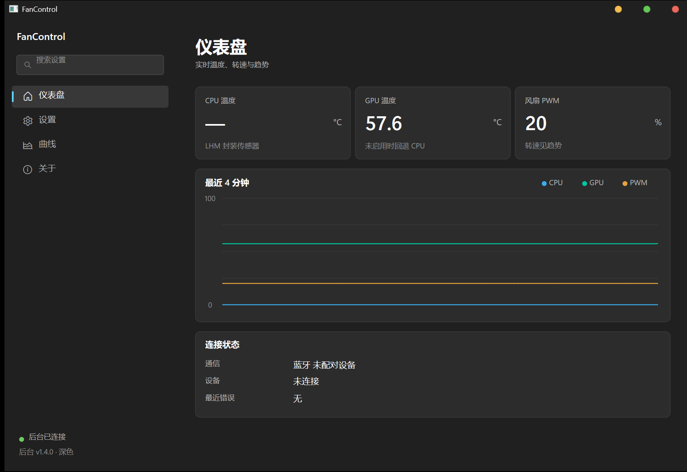
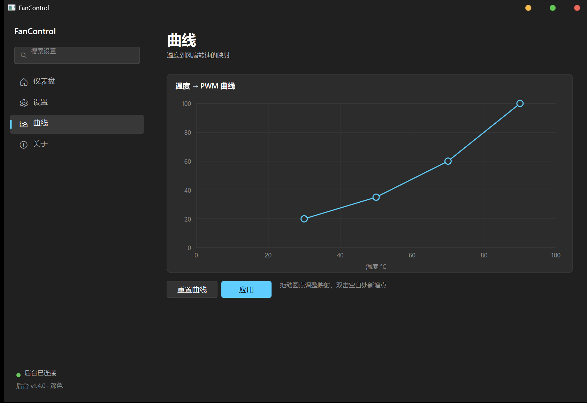
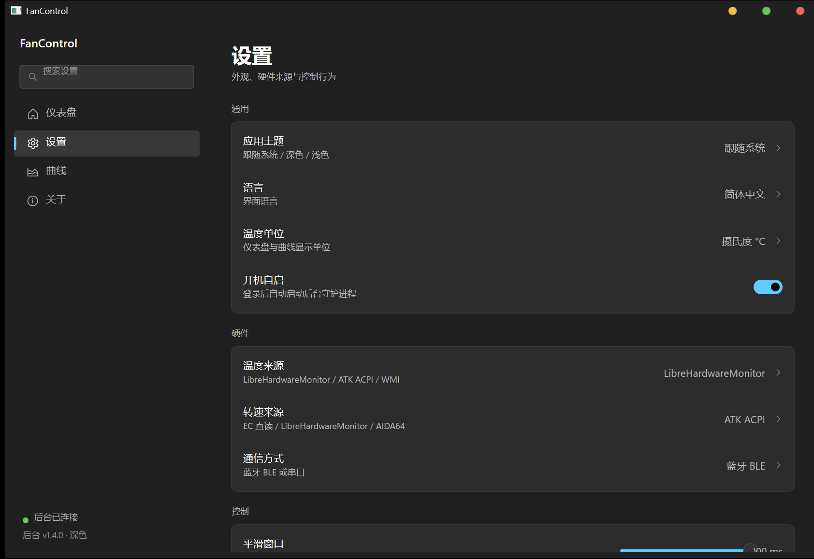
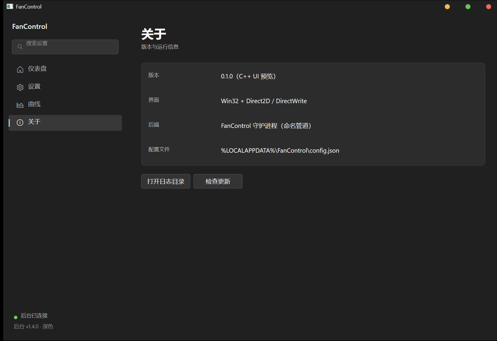

# FanControl

[中文](README.md) | **English**

> FanControl is a companion host app for the open-source hardware by Bilibili creator [垃圾研究社](https://www.bilibili.com/video/BV1Lr421M7u2/). A matching firmware and host app were rewritten for that hardware, forming a complete laptop fan control solution.

  

**Host repo**: [anlerway/Bluetooth-FanControl](https://github.com/anlerway/Bluetooth-FanControl)
**Firmware repo**: [anlerway/ESP32-LaptopFan](https://github.com/anlerway/ESP32-LaptopFan)

## Downloads

- **GitHub Releases**: <https://github.com/anlerway/Bluetooth-FanControl/releases/latest>
- Two forms: **installer** (with setup wizard, shortcuts, uninstaller) and **portable zip** (extract and run);
- Each form comes in two flavors: **self-contained .NET runtime** (no runtime install needed) and **requires .NET 8** (smaller size);
- If antivirus flags the build, add it to the whitelist or disable the AV temporarily; if you don't trust the binaries, clone the repo and build it yourself.

## Screenshots

| Dashboard | Curve editor |
| --- | --- |
|  |  |

| Settings | About |
| --- | --- |
|  |  |

> The UI is currently Chinese-only (the localization layer went away with the old WPF front end).

## Overview

A full remake built on top of the 垃圾研究社 open-source hardware:

- **Host app**: a resident background daemon (C#, tray + hardware access) plus a native UI (C++ / Direct2D, Windows 11 Settings look), adding auto-reconnect, auto-start, a control dashboard, more flexible temperature sources, and adjustable temperature-fan curves;

## Features

### Host app

- **Multiple temperature sources**: LibreHardwareMonitor / ASUS ATKACPI / WMI / AIDA64 / NVIDIA-SMI / ADL;
- **Independent CPU / GPU sources** — multi-GPU users can freely choose which GPU to read;
- **Adjustable temperature-fan curves**: 5 control modes (manual / CPU temp / GPU temp / mixed max / mixed average / target RPM), editable temperature and RPM curves, with fan-curve smoothing;
- **Auto-reconnect**: BLE / COM dual channels; automatically retries reconnection on disconnect, with manual reconnect support;
- **Auto-start**: starts quietly in the tray at logon and connects over Bluetooth directly;
- **Control dashboard**: live temperature / PWM / RPM tiles plus custom trend charts (CPU/GPU/PWM);
- **Tray resident**: tray temperature preview, disconnect/error notifications, close-to-tray.

## Software Settings

### First-time Use
- Whether you use the installer or the portable version, the software will prompt you to choose a location for user data before startup. You may select either the **installation directory** or the **AppData** folder.

### Auto-start and Auto-reconnect
- It is recommended to enable **Start with Windows**. The software will then launch automatically upon system boot and take over fan control.
- Regardless of which side (PC or hardware device) comes online first, the software will automatically connect once both are available—no manual intervention is needed.

### Configuring Temperature Data Sources
- After opening the software, go to the Settings page and select an appropriate data source (e.g., LibreHardwareMonitor, ATKACPI, etc.).
- For ASUS laptop users, it is recommended to directly choose **ATKACPI** mode.
- Switch to the Dashboard and wait until temperature readings appear normally.

### Control Modes
- Choose your preferred control mode (Manual, CPU Temperature, GPU Temperature, Mixed Max, Mixed Average, Target RPM, etc.) in the Settings or Curve Editor.
- The Dashboard will display real-time PWM output and the fan curve.

### Communication Connection Methods

#### BLE (Low Energy Bluetooth) Mode (Recommended)
1. After the ESP32 device is powered on, it will broadcast a Bluetooth signal named `LAPTOP-FAN`. Pair it using your computer's Bluetooth settings.
2. Open the host software, set the communication method to **BLE**, and select `LAPTOP_FAN` from the device list—no other configuration is required.
3. Wait a moment; the connection should succeed, and the ESP32's OLED screen will start showing data.

#### Serial (COM) Mode (Fallback)
1. After the ESP32 device is powered on, press the menu button to switch from `BT Mode` to `COM`. The device will restart automatically and broadcast a Bluetooth signal named `LAPTOP-FAN-COM`.
2. Pair `LAPTOP-FAN-COM` in your computer's Bluetooth settings; this will create a virtual COM port.
3. Open the host software, set the communication method to **COM**, set the baud rate to `115200`, and select the corresponding COM port.
4. Once connected, the ESP32's OLED screen will display data.

## Architecture

Two processes:

- **`FanControl.Host.exe`** (C#, administrator) runs resident and owns the sampling loop, PWM computation, BLE/COM communication, config persistence and the tray icon;
- **`FanControl.UI.exe`** (C++20 + Direct2D/DirectWrite, standard user) is started on demand and talks to the daemon over the `FanControl.Host.v1` named pipe; closing the UI leaves fan control running.

```text
FanControl.slnx
├── src/
│   ├── FanControl.Shared/    # Shared contracts: enums / models / IPC framing
│   ├── FanControl.Service/   # Library: sampling loop, hardware sources, communication, config, logging, tray
│   ├── FanControl.Host/      # Background daemon (C#, resident, tray + named-pipe server)
│   └── FanControl.UI.Cpp/    # UI (C++20, Direct2D custom drawing, Windows 11 Settings style)
├── installer/                # Inno Setup script and one-shot packaging script
├── tests/FanControl.Tests
└── docs/                     # Architecture, device protocol and IPC protocol docs
```

Sampling chain: `temperature source (independent CPU/GPU) → curve lookup by mode → PWM smoothing → send over BLE/COM → OLED display`.

Ownership: temperatures/RPM/PWM/connection state and config writes live only in the daemon; the UI only owns the current page, scroll position and an in-progress curve edit. See [docs/ARCHITECTURE.md](docs/ARCHITECTURE.md) and [docs/PROTOCOL.md](docs/PROTOCOL.md).

## Environment

### Host app

- Windows 10/11 x64;
- .NET 8 SDK (8.0.423+) — to build the daemon and libraries;
- MSVC (Visual Studio 2026 Build Tools or IDE) + Windows SDK 10, C++20 — to build the UI;
- Inno Setup 6 (to build installers).

## Build

Prerequisites: .NET 8 SDK (8.0.423+) for the daemon, MSVC + Windows SDK 10 for the UI.

```powershell
# Daemon, libraries & tests
dotnet build src\FanControl.Host\FanControl.Host.csproj -c Debug
dotnet test tests\FanControl.Tests

# UI (C++): build.bat calls vcvars64 and then cl
cd src\FanControl.UI.Cpp
build.bat
# or with CMake (bundled with Visual Studio)
cmake -B build -S . && cmake --build build --config Release
```

### One-shot packaging (two flavors)

```powershell
powershell -NoProfile -ExecutionPolicy Bypass -File installer\_build-release.ps1
```

The script builds the C++ UI, publishes the daemon in both flavors, copies `FanControl.UI.exe` into the publish folder, zips it and calls Inno Setup. Artifacts land **outside** the repo in `..\..\artifacts\`.

| Form | Self-contained (no .NET needed) | Needs .NET 8 |
| --- | --- | --- |
| Portable zip | `..\..\artifacts\release\FanControl-1.4.0-selfcontained-win-x64.zip` (~34 MB) | `..\..\artifacts\release\FanControl-1.4.0-framework-win-x64.zip` (~2.5 MB) |
| Installer | `..\..\artifacts\installer\FanControl-Setup-Full-1.4.0.exe` (~27 MB) | `..\..\artifacts\installer\FanControl-Setup-Slim-1.4.0.exe` (~4 MB) |

> `_build-release.ps1` must stay saved as **UTF-8 with BOM**: PowerShell 5.1 parses BOM-less files as GBK and mangles the Chinese literals.

## Run

Run `FanControl.UI.exe` from the publish output (or use the installer / portable zip from a release). If the daemon is not running, the UI elevates and starts `FanControl.Host.exe`; you can also run the daemon alone and stay in the tray:

- UI: dashboard (live temperatures/trend), settings, curve editor, about;
- Tray (owned by the daemon): open UI / reconnect / auto-start / exit; closing the UI keeps fan control running;
- The daemon needs administrator rights (hardware sensors); auto-start runs silently with highest privileges via Task Scheduler;
- Both exes must sit in the same folder (the UI looks for the daemon next to itself and vice versa).

## Temperature sources

| Source | Description |
| --- | --- |
| LibreHardwareMonitor | Default, real hardware sensors (CPU Package/Tctl/Tdie, GPU temp, fan RPM) |
| ATKACPI | ASUS laptops only (reference: G-Helper) |
| WMI | MSAcpi_ThermalZoneTemperature thermal zones |
| AIDA64 | Registry SensorValues (requires “Allow monitoring data to registry” in AIDA64) |
| NVIDIA-SMI / ADL | GPU-only chain: NVIDIA official tool → AMD driver library |

## Protocol

One ASCII line per frame, terminated with `\r\n`:

- Host → firmware: `PWM:<0-100>`, `TIME:yyyy/MM/dd HH:mm:ss`, `CPU<temp>`, `GPU<temp>`;
- Firmware → host: `READY` (handshake), `STATUS:...` (query reply).

## References & open-source hardware

| Project | Description | Link |
| --- | --- | --- |
| 垃圾研究社 | Adapted open-source hardware solution | <https://www.bilibili.com/video/BV1Lr421M7u2/> |
| G-Helper | ASUS device control reference | <https://github.com/seerge/g-helper> |
| LibreHardwareMonitor | Hardware monitoring library | <https://github.com/LibreHardwareMonitor/LibreHardwareMonitor> |

## Disclaimer

Fan control affects hardware cooling; adjust curves carefully. Firmware/host are provided as-is; use at your own risk.
If antivirus flags the build, add it to the whitelist or disable the AV; if you don't trust the binaries, clone the repo and build it yourself.
