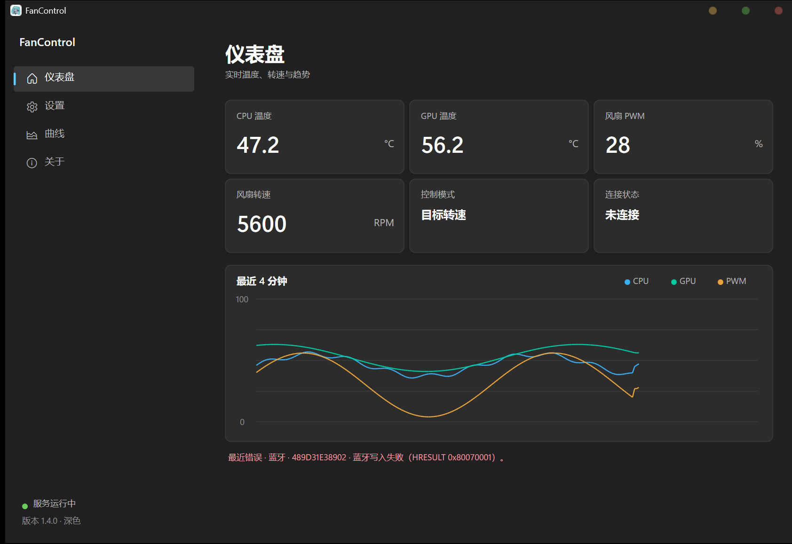
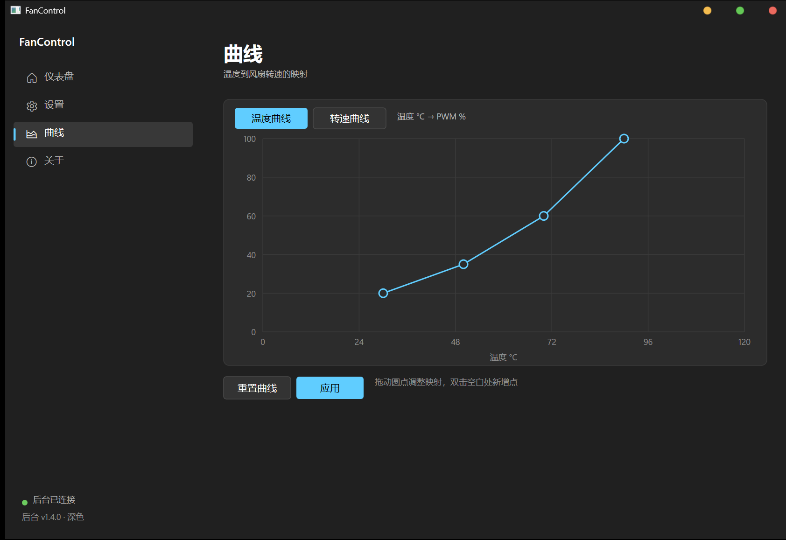
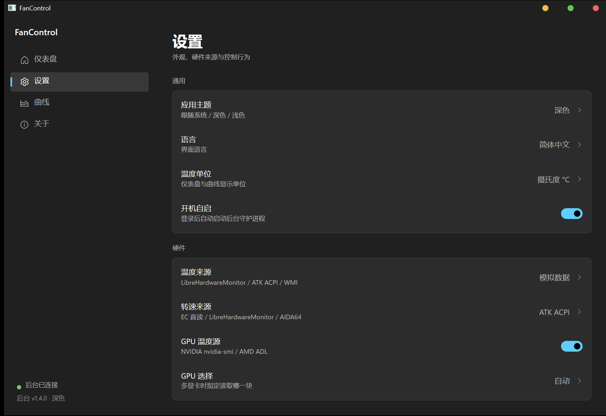
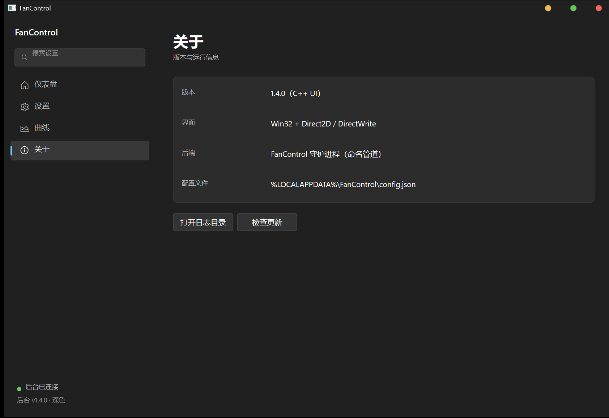
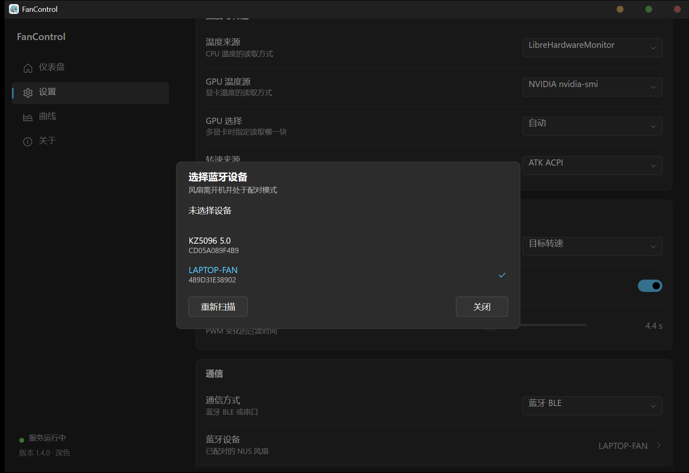

# FanControl

[English](README.en.md) | **中文**

> 本软件是 UP 主[垃圾研究社](https://www.bilibili.com/video/BV1Lr421M7u2/)开源硬件的**适配上位机**，并针对该硬件与**重写了一套固件和软件**，组成完整的笔记本风扇控制方案。

  

**上位机仓库**：[anlerway/Bluetooth-FanControl](https://github.com/anlerway/Bluetooth-FanControl)
**固件仓库**：[anlerway/ESP32-LaptopFan](https://github.com/anlerway/ESP32-LaptopFan)

## 下载

- **GitHub Releases**：<https://github.com/anlerway/Bluetooth-FanControl/releases/latest>
- 提供 **安装包**（带安装向导、快捷方式、卸载）与 **免安装 zip**（解压即用）两种形态；
- 每种形态分 **自带 .NET 运行库**（免装环境）与 **需 .NET 8 环境**（体积更小）两个版本；
- 如遇杀软误报，请加入白名单或关闭杀软；不信任发行版可自行克隆仓库编译。

## 界面预览

| 仪表盘 | 曲线编辑 |
| --- | --- |
|  |  |

| 设置 | 关于 |
| --- | --- |
|  |  |

| 蓝牙设备选择 |
| --- |
|  |

> 界面支持简体中文与英文，可在 **设置 → 语言** 切换（英文界面见 [README.en.md](README.en.md)）。选择写入 `AppConfig.Language`，重启后保持。

> 设置页按用途分成五张卡：温度与转速、风扇控制、通信、系统、外观与通知，共 27 项，选择项都是行内下拉框；只有「蓝牙设备」会弹出居中面板（要同时显示设备名与 MAC，行内放不下）。串口与蓝牙的行按当前通信方式只显示其中一套。配置文件路径与字段沿用 1.3.0（`%AppData%\FanControl\Config\` 或安装目录 `Userdata\Config\`），安装包 AppId 也未变，可直接覆盖升级。

## 简介

在垃圾研究社开源硬件的基础上，针对实际体验做了完整重制：

- **上位机**：单一进程（C# 宿主，常驻托盘，进程内加载 C++ / Direct2D 原生界面），新增自动重连、开机自启、控制面板、更多更自由的温度源获取、可调节的温度-风扇曲线；

## 功能特性

### 上位机（软件）

- **多温度数据源**：LibreHardwareMonitor / 华硕 ATKACPI / WMI / AIDA64 / NVIDIA-SMI / ADL / 联想 WMI；
- **CPU / GPU 获取方式独立选择**，针对多GPU用户可自由选择GPU；
- **可调节温度-风扇曲线**：5 种控制模式（手动 / CPU 温度 / GPU 温度 / 混合取最高 / 混合平均 / CPU 风扇转速映射），温度曲线与转速曲线并排编辑，改动即时生效、自动保存，可撤回最近 32 步，风扇曲线支持平滑；
- **自动重连**：BLE / COM 双通信链路，连接断开自动按轮询重连，支持手动重连；
- **开机自启**：开机直接驻留托盘，直接进行蓝牙连接；
- **控制面板**：实时温度 / 输出 PWM / CPU 风扇转速卡片 + 自绘趋势曲线（CPU / GPU / 输出 PWM / CPU 风扇转速，转速走右轴），曲线页另有输出 PWM 的最近 4 分钟走势；
- **错误分级**：提示 / 异常 / 错误 / 验证错误 四档，界面「最近错误」与提示条按级别上色，日志每行带同一套级别标记；
- **托盘常驻**：托盘温度预览、断开/错误通知、关闭主窗口最小化到托盘；

## 软件设置

### 首次使用
- 不论是安装包版还是绿色版，启动前会提示选择用户数据存储位置，您可以选择放到 **安装目录** 或 **AppData** 目录。

### 开机自启与自动连接
- 建议打开 **开机自启**，下次启动电脑时会自动运行并控制风扇。
- 无论电脑与硬件设备谁先上线，软件均会在上线后自动连接，无需手动干预。

### 配置温度数据源
- 打开软件后，进入设置页面，选择合适的数据源（如 LibreHardwareMonitor、ATKACPI 等）。
- 华硕笔记本用户建议直接选择 **ATKACPI** 模式。
- 切换至仪表盘，直到温度数据正常输出。

### 控制模式
- 在设置或曲线编辑中选择合适的控制模式（手动、CPU温度、GPU温度、混合最高、混合平均、CPU 风扇转速映射等）。
- 仪表盘会实时显示 PWM 输出和风扇曲线。

### 通信连接方式

#### BLE 低功耗蓝牙模式（推荐）
1. ESP32设备上电后，会广播名为 `LAPTOP-FAN` 的蓝牙信号，使用电脑进行蓝牙配对。
2. 打开上位机软件，通信方式选择 **BLE**，点「蓝牙设备」弹出设备列表（打开即扫描已配对设备），选中 `LAPTOP-FAN`，无需其他配置。
3. 稍等片刻即可连接成功，ESP32端OLED屏幕显示数据

#### 串口（COM）模式（备用）
1. ESP32设备上电后，点击菜单键，将 `BT Mode` 切换为 `COM`，设备会自动重启并广播 `LAPTOP-FAN-COM` 的蓝牙信号。
2. 在电脑蓝牙中配对 `LAPTOP-FAN-COM`，系统会生成虚拟 COM 端口。
3. 打开上位机，通信方式选 **COM**，波特率 `115200`，在「串口端口」里选中对应的 COM 口（列表由宿主枚举，插拔后重新点开即可刷新）。
4. 连接成功后， ESP32端OLED屏幕显示数据

## 架构

单一进程，界面是它加载的 DLL：

- **`FanControl.exe`**（C#，带管理员清单）是唯一的进程：常驻运行，独占采样循环、PWM 计算、BLE/COM 通信、配置落盘与托盘图标；
- **界面 `FanControl.UI.dll`**（C++20 + Direct2D/DirectWrite）由宿主进程内 `LoadLibrary` 加载，在独立 STA 线程上建窗口；关掉窗口只是销毁它，采样与控风扇照常；
- 宿主与界面之间没有管道，只剩一次函数调用：宿主每 400 ms 把状态序列化成 JSON 调 `FcUiPush`，界面把命令序列化成 JSON 交给 `FcUiSetCommandSink` 注册的回调（报文格式与 1.4.0 一致）；
- 只有一个进程，所以不需要启动器，也不会出现孤儿窗口。

```text
FanControl.slnx
├── src/
│   ├── FanControl.Shared/    # 共享契约：Enums / Models（配置、数据包）/ 错误码
│   ├── FanControl.Service/   # 类库：采样循环、硬件数据源、通信、配置、日志、托盘
│   ├── FanControl.Host/      # 单一进程宿主（C#，产物 FanControl.exe：托盘 + 采样 + 界面桥）
│   ├── FanControl.UI.Cpp/    # 界面（C++20，Direct2D 自绘，编译成 FanControl.UI.dll）
│   └── FanControl.Ble.Native # 蓝牙原生桥（C++/WinRT → FanControl.Ble.dll，服务层 P/Invoke 调用）
├── installer/                # 手写安装器/卸载器（C++20 + Direct2D）与一键打包脚本
├── tests/FanControl.Tests
└── docs/                     # 架构、通信协议与界面协议文档
```

采样链路：`温度数据源（CPU/GPU 独立）→ 控制模式查曲线 → PWM 平滑 → BLE/COM 下发 → OLED 显示`。

状态归属：温度/转速/PWM/连接状态与配置写盘只在宿主；界面只管当前页、滚动与曲线草稿。细节见 [docs/ARCHITECTURE.md](docs/ARCHITECTURE.md)，界面报文见 [docs/PROTOCOL.md](docs/PROTOCOL.md)。

## 环境配置

### 上位机

- Windows 10/11 x64；
- 宿主与类库：.NET 8 SDK（8.0.423+）——仅编译源码需要；
- 界面：MSVC（Visual Studio 2026 生成工具或完整版）+ Windows SDK 10，C++20；
- 蓝牙：Windows SDK 自带的 C++/WinRT 头文件（链接 `WindowsApp.lib`），随原生桥一起编译；
- Python 3（仅打安装包时用标准库 `lzma`；无需第三方包）。

## 构建

前置：.NET 8 SDK（8.0.423+）编译宿主；MSVC + Windows SDK 10 编译界面。

先编界面，再编宿主（宿主工程会把 `FanControl.UI.dll` 拷到自己的输出目录）：

```powershell
# 界面（C++）：build.bat 会先 call vcvars64 再调 cl，产出 build\FanControl.UI.dll
cd src\FanControl.UI.Cpp
build.bat
# 或用 CMake（VS 自带 cmake）
cmake -B build -S . && cmake --build build --config Release

# 蓝牙原生桥（C++/WinRT）：build.bat 产出 build\FanControl.Ble.dll，宿主构建/发布会把它拷到输出目录
cd src\FanControl.Ble.Native
build.bat
cd ..\..

# 宿主、类库与测试：产物是 bin\Debug\net8.0-windows\FanControl.exe + FanControl.UI.dll + FanControl.Ble.dll
dotnet build src\FanControl.Host\FanControl.Host.csproj -c Debug
dotnet test tests\FanControl.Tests
```

### 一键打两个发行版本

```powershell
powershell -NoProfile -ExecutionPolicy Bypass -File installer\_build-release.ps1
```

脚本依次：编译 C++ 界面（`build\FanControl.UI.dll`）→ `dotnet publish` 宿主（两种 flavor）→ 把 DLL 拷进发布目录 → 打 zip → 编原生安装器（`installer\native\build.bat`，同一份源码出 `setup.exe` 与 `uninstall.exe`）→ `installer\pack.py` 把两份负载以 raw LZMA2 追加进 `setup.exe`。产物输出到**仓库外**的 `..\..\artifacts\`（可用 `-ReleaseRoot` / `-InstallerRoot` 改）：

| 形态 | 自带运行库（免装 .NET） | 需 .NET 8 |
| --- | --- | --- |
| 免安装压缩包 | `..\..\artifacts\release\FanControl-2.0.0-selfcontained-win-x64.zip`（约 34 MB） | `..\..\artifacts\release\FanControl-2.0.0-framework-win-x64.zip`（约 2.5 MB） |
| 安装包（一份，按环境自动选负载） | `..\..\artifacts\installer\FanControl-Setup-2.0.0.exe`（约 28 MB，内含两份负载） | — |

> 安装包阶段**不检测** .NET 运行环境，避免未装 .NET 的机器直接安装失败；需环境版装好后由程序自身提示。
> `_build-release.ps1` 必须保持 **UTF-8 with BOM** 保存：PowerShell 5.1 会把无 BOM 文件里的中文按 GBK 解析，导致参数默认值被吃掉。

## 运行

解压免安装压缩包或安装后运行 `FanControl.exe`（卸载、快捷方式、安装器都指向它）：

- 界面：仪表盘（实时温度/趋势）、设置、曲线编辑器、关于；
- 托盘（同一个进程）：打开主界面 / 重建连接 / 开机自启 / 退出；关掉窗口不影响风扇控制，托盘图标还在；
- 需要管理员权限（访问硬件传感器），开机自启通过任务计划以最高权限静默运行；
- `FanControl.exe` 与同目录的 `FanControl.UI.dll` 必须放在一起：找不到 DLL 时宿主只留托盘并弹框提示。
- 开机自启的计划任务动作是 `<安装目录>\FanControl.exe --autostart`，与 1.3.0 完全一致——从旧版升级后原有自启任务继续有效，无需重设。
  任务由安装器和托盘开关写成**完整任务 XML**（不再是 `schtasks /Create /TR` 那一行）：关掉「电池供电时不启动」、带上工作目录与当前用户身份，笔记本拔掉电源登录也会启动；任务建不出来时退到 `HKCU\...\Run`。
- 卸载：先结束 `FanControl.exe`、删掉计划任务与 `Run` 项、删快捷方式和注册表，再删程序文件；卸载器把自己也删掉
  （Windows 不允许删除正在运行的 exe，由 `%TEMP%` 里的副本进程收尾；只剩卸载器的目录连目录一起删），
  只有勾选「同时删除用户数据」才会动 `%APPDATA%\FanControl`。
- 安装/卸载过程记在 `%ProgramData%\FanControl\setup.log`（建任务、写注册表、自删除等步骤都有记录），出问题时先看这份日志。

## 数据源说明

| 数据源 | 说明 |
| --- | --- |
| LibreHardwareMonitor | 默认，真实硬件传感器（CPU Package/Tctl/Tdie、GPU 温度、风扇转速） |
| ATKACPI | 华硕机型专用（参考项目G-Helper） |
| WMI | MSAcpi_ThermalZoneTemperature 热区温度 |
| AIDA64 | 注册表 SensorValues（需 AIDA64 开启“允许监控数据写入注册表”） |
| NVIDIA-SMI / ADL | GPU 专用链路：NVIDIA 官方工具 → AMD 驱动库 |
| Lenovo WMI | 联想机型专用：`LENOVO_FAN_METHOD` / `LENOVO_FAN_TABLE_DATA`，只读温度与转速（参考 LenovoLegionToolkit） |

## 通信协议

一行 ASCII 文本帧，`\r\n` 结尾：

- 上位机 → 固件：`PWM:<0-100>`、`TIME:yyyy/MM/dd HH:mm:ss`、`CPU<温度>`、`GPU<温度>`；
- 固件 → 上位机：`READY`（连接握手）、`STATUS:...`（查询应答）。

## 参考与开源硬件

| 项目 | 说明 | 链接 |
| --- | --- | --- |
| 垃圾研究社 | 适配的硬件开源方案 | <https://www.bilibili.com/video/BV1Lr421M7u2/> |
| G-Helper | 华硕设备控制参考 | <https://github.com/seerge/g-helper> |
| LenovoLegionToolkit | 联想设备控制参考 | <https://github.com/LenovoLegionToolkit-Team/LenovoLegionToolkit> |
| LibreHardwareMonitor | 硬件监控库 | <https://github.com/LibreHardwareMonitor/LibreHardwareMonitor> |

## 免责声明

风扇控制涉及硬件散热，请谨慎调节转速曲线；固件/上位机按现状提供，使用风险自负。
如果遇到报毒，请加入白名单或关闭杀软，如果您不信任发行版本，可自行克隆仓库编译。
